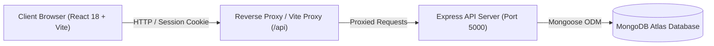

# Applied

> A calm, disciplined job and internship application tracker designed specifically for students and early-career job seekers.

[]()
[]()
[]()

---

## The Pitch

Job hunting as a student is noisy and stressful. Tracking dozens of internship postings across LinkedIn, Internshala, Unstop, and college placement cells quickly deteriorates into disorganized spreadsheets, forgotten online assessments, and missed interview deadlines.

Generic job trackers are often bloated SaaS clones built around complex Kanban boards, aggressive sales pipelines, or demoralizing statistics.

**Applied** is built differently:
- **Calm by design**: Flat, clear paper-and-ink aesthetics with zero aggressive colors, zero eye-straining card lifts, and zero unnecessary visual clutter.
- **Time-focused**: The signature **Deadline Ruler** visualizes your next 14 days chronologically, so you never miss a coding test or interview preparation window.
- **Disciplined logging**: Tracks responses through every stage (assessment, assignment, interview, offer, rejection) with dates, notes, and completion checks.
- **Student-first**: Tailored for Indian students and internships with native ₹ (INR) support, college platforms, and zero demoralizing "ghosted" percentages.

---

## Visual Tour

### Public Landing Page with Deadline Ruler Preview (Light Mode)


### Public Landing Page (Dark Mode)


### Desktop Dashboard with Interactive Deadline Ruler


### Desktop Dashboard (Dark Mode)


### Application Detail with Multi-Stage Reply Timeline


### Mobile Experience (Dark Mode)


---

## Key Features

- **Public Marketing Landing Page**: A calm, left-aligned introduction to Applied with an interactive preview of the signature Deadline Ruler and 3-step static workflow slices.
- **URL-Driven Auth Modal**: Clean native `<dialog>` authentication with desktop focus trap and mobile bottom-sheet styling, triggered via `/?auth=login` and `/?auth=register`.
- **Chronological Deadline Ruler**: An interactive 14-day timeline displaying upcoming assessments and interviews in non-overlapping collision-free lanes.
- **Application Directory**: Full-text company search, platform filters, status segmentation, and reply tracking with URL-synchronized state and pagination.
- **Multi-Stage Reply Timeline**: Add and manage updates for assessments, take-home projects, and interviews with deadlines, notes, and one-click completion toggles.
- **Automatic Status Derivation**: Automatically updates status to "In process" when reply dates or deadlines exist, or "Rejected" / "Offer" based on your latest reply.
- **Strict WCAG 2.1 AA Accessibility**: Full keyboard navigation, semantic headings and landmark regions, screen reader announcements, zero Axe-core violations, and `prefers-reduced-motion` support.
- **Offline & Reconnection Resilience**: Global network awareness with offline state notifications and auto-recovery.
- **Centralized Brand System**: Rebrand the entire application in a single file (`frontend/src/lib/brand.js`) or via `VITE_APP_NAME` in `.env`.

---

## Tech Stack

### Frontend
- **Framework**: React 18 with Vite
- **Styling**: Tailwind CSS v4 with custom semantic CSS variable design tokens
- **Data Fetching & Caching**: TanStack React Query v5
- **Icons**: Lucide React
- **Typography**: Variable `Schibsted Grotesk` (self-hosted)

### Backend
- **Runtime**: Node.js & Express
- **Database**: MongoDB & Mongoose
- **Authentication**: Session-based auth (`express-session` with MongoDB session store and secure `HttpOnly` cookies)
- **Validation**: Zod schema validation on requests and queries
- **Security**: Helmet, Express rate limiters, bcrypt password hashing

---

## Architecture



---

## Quick Start

### 1. Clone the repository
```bash
git clone https://github.com/Brijesh667/Applied.git
cd Applied
```

### 2. Configure Backend
```bash
cd backend
npm install
```

Create a `backend/.env` file:
```env
PORT=5000
MONGO_URI=mongodb://localhost:27017/applied
SESSION_SECRET=your_super_secret_session_key_minimum_32_characters
CLIENT_URL=http://localhost:5173
NODE_ENV=development
```

*(Optional)* Seed demo data:
```bash
SEED_EMAIL=you@example.com SEED_PASSWORD=<your-password> npm run seed
```

Start the backend:
```bash
npm run dev
```

### 3. Configure Frontend
In a new terminal:
```bash
cd frontend
npm install
npm run dev
```

Open `http://localhost:5173` in your browser.

---

## Design Decisions

| Decision | Why We Made It |
|---|---|
| **No "Reply Rate" Metric** | For students applying to competitive internships, a low reply rate percentage (e.g. 4%) is demoralizing and unhelpful. Applied focuses on what is actionable: what needs to be prepared today. |
| **Deadline Ruler over Kanban** | Kanban boards work for teams moving cards horizontally across stages, but job hunting is fundamentally constrained by deadlines (assessment due dates, interview schedules). The ruler gives immediate temporal clarity. |
| **Flat Surfaces with Status Edge** | Rather than heavy drop shadows and decorative 3D gradients, Applied uses subtle, paper-like flat surfaces with a clean 4px left border edge indicating application status. |
| **Indian Rupee (₹) Default** | Designed specifically with Indian students and internships in mind, featuring standard Indian number grouping (`₹1,50,000 / month`) alongside common platform presets (LinkedIn, Internshala, Unstop). |
| **Session Cookies over JWT in localStorage** | `HttpOnly` session cookies protect user authentication against XSS token theft, provide straightforward expiration handling, and eliminate client-side token refresh complexity. |
| **Session Hint for Returning Users** | A non-sensitive boolean flag (`session-hint = "1"`) prevents flashes of the public landing page on page load without storing user details or tokens. |
| **URL-Driven Auth Modal** | Native `<dialog>` controlled via `?auth=login` and `?auth=register` keeps authentication lightweight and seamlessly integrated with deep-linking and browser navigation. |

---

## Verification & Quality Assurance

- **Linting**: Run `npm run lint` inside `frontend/` (0 errors, 0 warnings).
- **Production Build**: Verified with `npm run build` ($< 100\text{ kB}$ gzip initial landing footprint, CSS $< 10\text{ kB}$ gzip).

---

## License

MIT License. Built with discipline.
